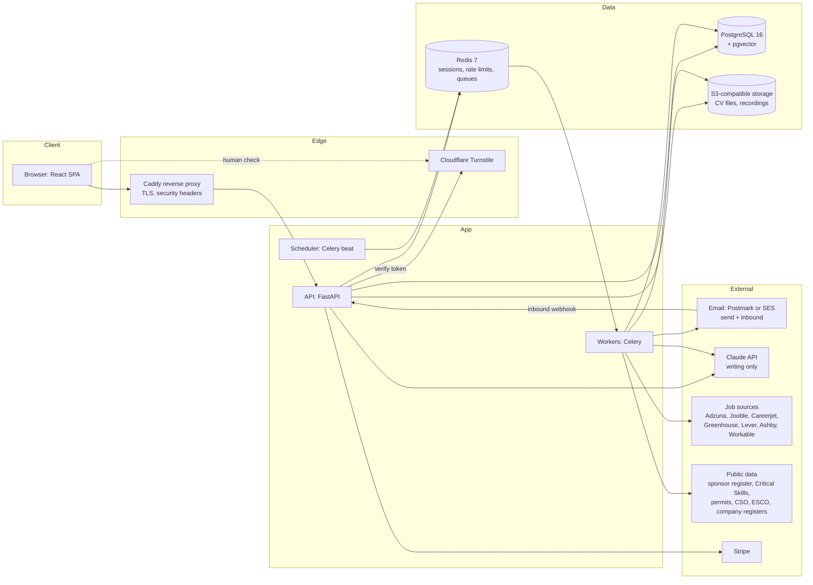
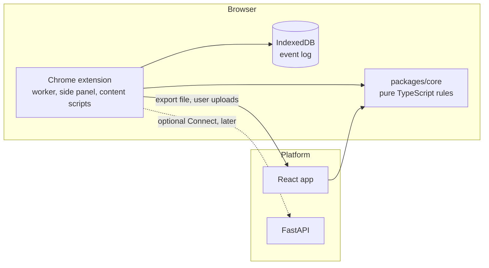

# 01 · Architecture

## System overview



## Services

| Service | Tech | Responsibility |
| --- | --- | --- |
| `frontend` | React, TypeScript, Vite | Marketing site and app. Static build served by Caddy in production. |
| `api` | FastAPI on Uvicorn (Gunicorn in prod) | REST API under `/api/v1`, auth, validation, business logic, webhooks |
| `worker` | Celery | Slow or scheduled work: CV parsing, PDF/DOCX rendering, AI calls, job ingestion, matching, digests, transcription, model training |
| `beat` | Celery beat | Schedules: nightly ingestion, morning digest, retention clean-up, model refresh |
| `postgres` | PostgreSQL 16 + pgvector | System of record. Embeddings in `vector` columns. |
| `redis` | Redis 7 | Celery broker, sessions, rate limits, short-lived codes, caching |
| `storage` | S3 API (MinIO locally) | Uploaded CVs, generated files, practice recordings (lifecycle expiry) |
| `caddy` | Caddy 2 | TLS, HTTP/2/3, security headers, static files, reverse proxy |
| `mailpit` | Dev only | Catches all outgoing email locally |

## Backend layout

```
backend/app/
├── main.py              # app factory, middleware, routers
├── core/                # config, logging, security headers, rate limits, errors
├── db/                  # engine, session, base model
├── models/              # SQLAlchemy models (one file per aggregate)
├── schemas/             # Pydantic request/response models
├── repositories/        # DB queries only
├── services/            # business logic (pure where possible, unit-tested)
├── auth/                # passkeys, email codes, sessions, bot protection
├── api/routes/          # HTTP routers, thin
├── workers/             # Celery app and tasks
├── ml/                  # scoring, matching, survival, uplift, calibration
├── integrations/        # job sources, email, AI, Stripe, public data loaders
└── content/             # loaders for /content data files
```

Dependency direction: `routes → services → repositories → models`. `services` may call
`integrations` and `ml`. Nothing imports from `routes`.

## Frontend layout

```
frontend/src/
├── main.tsx, App.tsx    # entry, router
├── styles/              # tokens.css (from design/tokens.json), global.css
├── components/          # design-system components (Button, Badge, Field, Switch, Tabs…)
├── layouts/             # MarketingLayout, AppShell (side nav)
├── pages/               # one folder per screen (see docs/08-screens.md)
├── features/            # feature logic and hooks (cv, jobs, applications, insights, interviews)
├── api/                 # typed API client (generated from OpenAPI) + TanStack Query hooks
└── lib/                 # helpers (formatting, a11y utilities)
```

The API client is generated from FastAPI's OpenAPI schema (`openapi-typescript`) so types
always match the backend.

## Key flows

**Sign-in (passkey first)** — see `06-security.md` for full sequence.

**CV upload → structured CV**
1. Browser uploads file → API checks size and type (magic bytes) → stores in S3 (private) →
   enqueues `parse_cv`.
2. Worker extracts text (pdfplumber / python-docx) in a sandboxed subprocess with a timeout →
   rules parser builds structured CV → AI fallback only for sections rules could not parse →
   validates against `cv.schema.json` → saves `cv_version`.
3. Frontend polls job status (or SSE) → opens the editor.

**Render and self-check**
Structured CV + template → HTML (Jinja2) → PDF (WeasyPrint) and DOCX (python-docx) →
re-extract text from the generated file → ATS self-check report.

**Daily matching**
Nightly: ingest jobs → normalise → de-duplicate (MinHash/LSH) → resolve companies →
enrich (visa, registry, reply stats) → embed. Morning: per user, cheap filters → hybrid
retrieval (BM25 + vector, reciprocal rank fusion) → scorer (rules v0, LightGBM later) →
calibrate → reasons → digest email.

**Reply capture**
Inbound email webhook → verify signature → match to user by forwarding address → classify
(rules, then logistic regression) → link to application → append `application_event` →
update rejection likelihood and survival statistics.

## Cross-cutting

- **Action log:** every user action that matters for analytics (saved, tailored, applied,
  followed up, replied, interviewed, offered) is an immutable `application_event` row with a
  timestamp. Build this in Stage 1–2 and never skip it. Uplift and survival models depend on it.
- **Feature flags:** simple DB-backed flags (`feature_flags` table) to switch models on per
  the data-maturity gates.
- **Observability:** structured JSON logs (structlog) with request IDs; Sentry for errors;
  Prometheus metrics endpoint for the API and workers.
- **Idempotency:** webhooks and payment calls use idempotency keys.

## Extension and shared packages (Track E, ADR 0007)



- `packages/core` (rules, scoring, parsers, schemas) is used by the extension and the React app.
  The backend re-implements only server-side parts and is checked against shared golden fixtures.
- The local extension edition has no arrow to the platform. Connect adds one, behind an optional
  permission. Full design: `docs/16-chrome-extension.md` §6.
